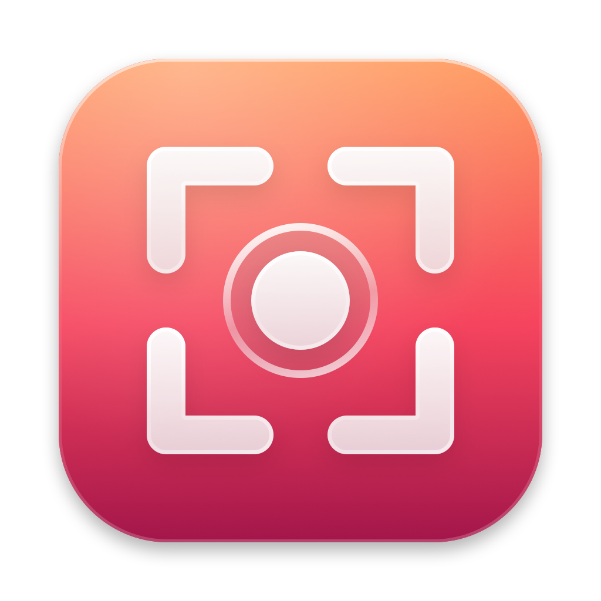

<p align="center">
  
</p>

<h1 align="center">Capture</h1>

<p align="center">
  Print e gravação de tela do macOS direto da barra de menus, sem decorar atalho.<br>
  Cada opção mostra o atalho nativo do lado, pra você ir aprendendo.
</p>

<p align="center">
  <a href="https://github.com/yagoramires/capture/releases/latest"><b>Baixar a última versão</b></a>
  ·
  <a href="https://github.com/yagoramires/capture/issues/new">Reportar problema</a>
</p>

---

## Por que existe

O macOS tem um bom sistema de captura de tela, mas ele fica escondido atrás de atalhos como `⇧⌘4`,
`⌃⇧⌘4` e `⇧⌘4` + Espaço + `⌥`, que são fáceis de esquecer. O Capture coloca todas essas opções num menu.
Não tem gravador próprio: tudo passa pelo `screencapture` do sistema, o mesmo que os atalhos usam,
com o mesmo som, a mesma qualidade e a mesma pasta.

## O que ele faz

Clique no ícone do Capture na barra de menus:

### Print: salva um arquivo

| Item | Atalho nativo |
| --- | --- |
| Tela inteira (do monitor onde está o mouse) | `⇧⌘3` |
| Parte selecionada | `⇧⌘4`. Enquanto arrasta: segure Espaço pra mover, `⇧` trava um lado, `⌥` cresce a partir do centro. Esc cancela. |
| Janela | `⇧⌘4`, depois Espaço e clique na janela |
| Janela sem sombra | `⇧⌘4`, depois Espaço, e clique na janela segurando `⌥` |

### Copiar: vai pra área de transferência

| Item | Atalho nativo |
| --- | --- |
| Tela inteira | `⌃⇧⌘3` |
| Parte selecionada | `⌃⇧⌘4` |
| Janela | `⌃⇧⌘4`, depois Espaço e clique na janela |

O `⌃` é a tecla **Control**, não a Option (`⌥`).

### Gravar vídeo

| Item | Atalho nativo |
| --- | --- |
| Tela inteira | `⇧⌘5`, depois **Gravar a Tela Inteira** |
| Parte selecionada | `⇧⌘5`, depois **Gravar a Parte Selecionada** |

Enquanto grava, o ícone vira um botão vermelho com o tempo. Pra parar, clique nele ou aperte `⌃⌘Esc`,
o atalho nativo. Quando termina, o vídeo aparece no Finder.

### Resto do menu

| Item | O que faz |
| --- | --- |
| Painel de captura do macOS (`⇧⌘5`) | Abre o painel nativo, igual ao atalho. |
| Abrir pasta das capturas | Abre a pasta onde os prints e vídeos são salvos. |
| Opções ▸ | As mesmas do `⇧⌘5` → Opções: **Salvar em** (muda a pasta do sistema também), **Timer** (nenhum, 5 ou 10 s, vale pra prints e gravações), mostrar o ponteiro do mouse, mostrar cliques, gravar o microfone e abrir depois de capturar. |
| Atualizar para a versão X… | Aparece quando tem versão nova. |
| Abrir ao iniciar sessão | Liga o Capture junto com o Mac. |
| Ajuda ▸ | Mostra a versão, busca atualizações, abre o log de depuração e reporta problemas. |

## Instalação

1. Baixe o `Capture-x.y.z.zip` na [página de releases](https://github.com/yagoramires/capture/releases/latest),
   descompacte e arraste o **Capture.app** pra pasta **Aplicativos**.
2. Abra o Capture. Como ele não é assinado com um certificado pago da Apple, na primeira vez o macOS
   avisa que não conseguiu verificar o desenvolvedor. Vá em **Ajustes do Sistema → Privacidade e
   Segurança**, role até o fim e clique em **Abrir Mesmo Assim**.
   Pelo Terminal também resolve: `xattr -dr com.apple.quarantine /Applications/Capture.app`
3. Na primeira captura, dê a permissão de **Gravação de Tela** (Ajustes do Sistema → Privacidade e
   Segurança → Gravação de Tela e Áudio do Sistema → Capture). Se for gravar com microfone, ele também
   pede o microfone.
4. Opcional: no menu, marque **Abrir ao iniciar sessão**.

Requer macOS 14 ou mais novo. Roda nativo em Apple Silicon e Intel.

### Atualizações

O Capture confere ao abrir (e uma vez por dia) se tem versão nova e oferece instalar: ele baixa,
troca o app e reabre sozinho. A versão baixada só é instalada se tiver sido assinada pelo mesmo
certificado do app em uso. Se você deixar pra depois, ele não insiste: o ícone ganha um sinal e o
menu mostra **Atualizar para a versão X…**.

### Desinstalar

1. No menu, desmarque **Abrir ao iniciar sessão** e clique em **Sair**.
2. Apague o **Capture.app** de Aplicativos.
3. Em **Ajustes do Sistema → Privacidade e Segurança → Gravação de Tela e Áudio do Sistema**, remova o Capture.
4. Opcional, pra apagar as opções e os logs: `defaults delete local.capture; rm -rf ~/Library/Logs/Capture`

## Privacidade

O Capture não coleta nem envia nada. Prints e vídeos ficam só no seu Mac, na pasta que você escolheu.
A única conexão de rede é a consulta à API pública do GitHub (`api.github.com`) pra saber se tem
versão nova, e o download dela quando você aceita atualizar.

## Problemas

Em **Ajuda → Reportar problema…**, o Capture abre uma issue no GitHub já com a versão, o macOS e os
monitores preenchidos, e mostra no Finder o log pra você anexar. O log fica em
`~/Library/Logs/Capture/capture.log` e só registra o que o app fez (qual captura, com quais opções,
o que o `screencapture` respondeu), nunca o conteúdo das capturas.

## Desenvolvimento

### Compilar

Só precisa das Command Line Tools (`xcode-select --install`), não do Xcode.

```sh
git clone https://github.com/yagoramires/capture.git && cd capture
scripts/setup-signing.sh   # uma vez: certificado local de assinatura (veja abaixo)
scripts/build.sh --run     # gera build/Capture.app e abre
```

O `setup-signing.sh` cria um certificado de assinatura local ("Aero Local Signing", o mesmo do
[Aero](https://github.com/yagoramires/aero)) no seu Chaveiro. A permissão de Gravação de Tela fica presa
à assinatura do app: com assinatura ad-hoc ela muda a cada build e o macOS para de confiar no app.

`scripts/make-icon.swift` gera o ícone (`Resources/AppIcon.icns`) a partir de código.

### Como funciona

| Arquivo | Papel |
| --- | --- |
| `Screencapture.swift` | Monta os comandos do `screencapture` pra cada tipo de print, cuida da gravação (`Recorder`), da pasta do sistema e das opções. |
| `AreaPicker.swift` | Seleção da área pra gravar: escurece os monitores e deixa arrastar um retângulo. |
| `AppDelegate.swift` | Menu da barra com os atalhos nativos, ícone de gravação e ponte de depuração. |
| `Updater.swift` | Confere releases no GitHub, baixa, valida a assinatura e troca o app. |
| `Log.swift` | Log de depuração em `~/Library/Logs/Capture/`, com rotação. |

### Depuração

```sh
defaults write local.capture debugBridge -bool true   # liga os comandos abaixo; reabra o app
scripts/debug.sh dump            # ambiente e o menu inteiro em /tmp/capture-debug.txt
scripts/debug.sh shot-screen     # print da tela inteira (também copy-screen)
scripts/debug.sh record-area     # grava uma área fixa de 400×300 (também record-screen)
scripts/debug.sh record-stop     # para a gravação
scripts/debug.sh toolbar         # abre o painel ⇧⌘5
scripts/debug.sh check-update    # o mesmo que "Buscar atualizações…"
scripts/debug.sh install-latest  # instala o último release sem perguntar
tail -f ~/Library/Logs/Capture/capture.log
```

### Publicar uma versão

1. Suba a versão em `Resources/Info.plist` (`CFBundleShortVersionString` e `CFBundleVersion`).
2. `scripts/build.sh --dist` gera o build universal e `dist/Capture-x.y.z.zip`.
3. Commit, push e `gh release create vX.Y.Z dist/Capture-x.y.z.zip`.

O release **precisa ser assinado com o mesmo certificado** das versões anteriores, senão os apps já
instalados recusam a atualização automática.

## Limitações

- O Touch Bar (`⇧⌘6`) não está no menu.
- Os prints e gravações do Capture não mostram a miniatura flutuante do canto da tela; use
  **Abrir depois de capturar** se quiser editar logo em seguida.
- Gravar só o áudio do sistema (sem microfone) não é possível pelo `screencapture`.

## Licença

[MIT](LICENSE)
